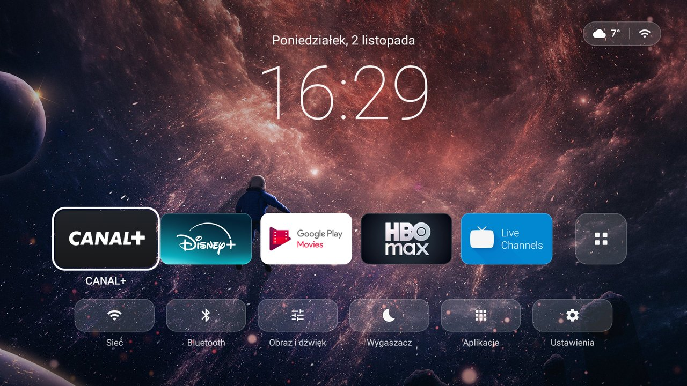
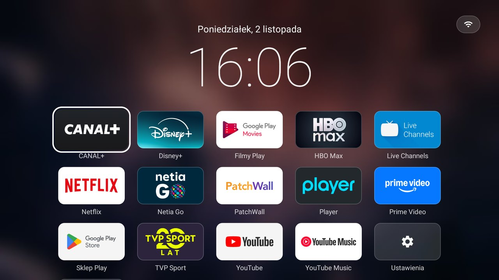
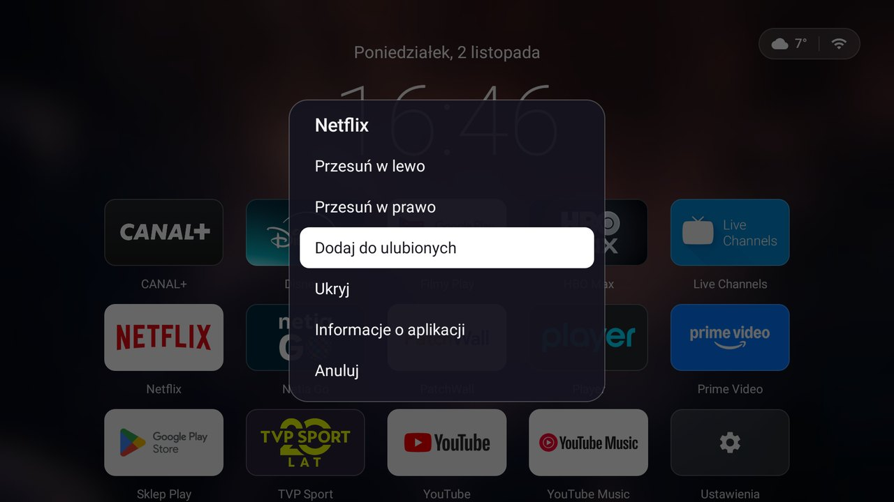
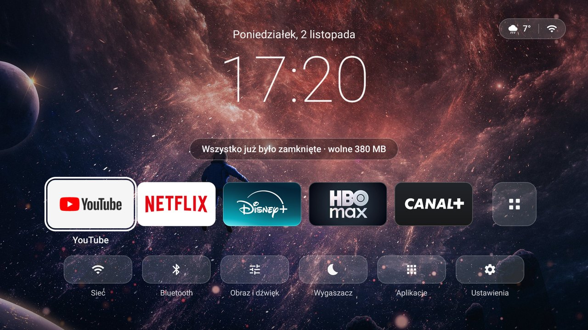
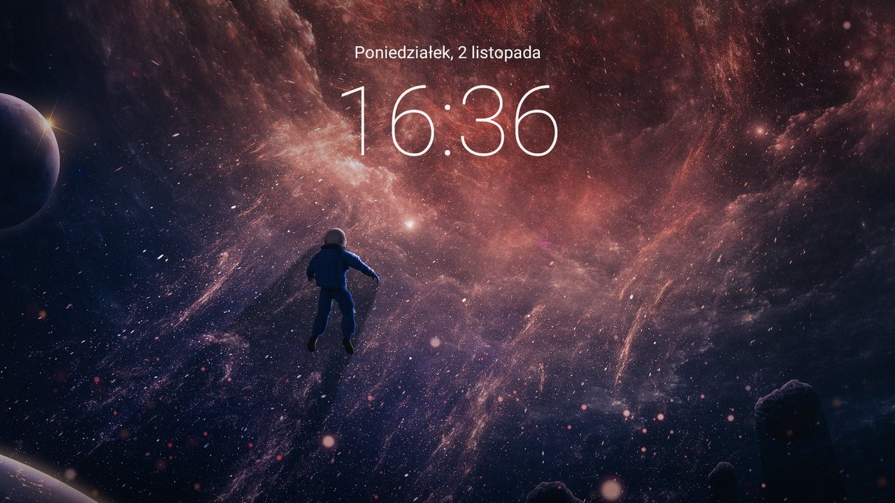

<div align="center">

# Czysty Launcher

**A lightweight, smooth home screen for Android TV.**
A clock, a wallpaper and your apps: no ads, no recommendations, no previews.


[Polska wersja](README.md) · [Download APK](../../releases/latest) · [Changelog](CHANGELOG.md)



</div>

*Czysty* means *clean* in Polish. The UI is in Polish; app names follow the system language.

## Why

The stock Google TV home is a catalogue of recommendation rows, banners and ads, with the apps you actually use somewhere underneath. On weak hardware like the **Xiaomi Mi TV Stick** (Amlogic S805Y, 1 GB RAM) it is also slow and stutters on every remote press.

Czysty Launcher does the opposite: turn the TV on and you get the date, a large clock, a wallpaper and a few favourite apps. It is written from scratch in Kotlin with classic Android Views: **no Jetpack Compose, no AndroidX, no libraries at all**. Every choice was measured on the real device.

## Features

| | |
|---|---|
| 🏠 **Home** | Date, large clock, weather and network status, a dock of favourites, quick settings |
| 🧊 **Glass style** | Translucent tiles with a rim; focus scales them ×1.1 with a white outline |
| 📱 **All apps** | 5-column grid over a blurred wallpaper; apps installed from Play Store appear automatically |
| ⭐ **Favourites & order** | Hold OK to move, add/remove from favourites, hide, or open app info |
| 🚀 **Booster** | The circle button closes background apps and shows how much memory was freed |
| 🌙 **Screensaver** | Just the wallpaper with date and time, also available as the system screensaver |
| 🌤️ **Weather** | Open-Meteo, falling back to met.no or wttr.in; no account and no device location |
| ⚡ **Performance** | 0% janky frames while navigating, ~25 MB of memory, 0% CPU when idle |

<table>
<tr>
<td><br><sub>All apps</sub></td>
<td><br><sub>Menu after holding OK</sub></td>
</tr>
<tr>
<td><br><sub>Booster (circle button)</sub></td>
<td><br><sub>Screensaver</sub></td>
</tr>
</table>

## Remote

On the Xiaomi remote (Mi TV Stick / Mi Box):

| Button | Action |
|---|---|
| **OK** | launch the app |
| **Hold OK** or **Menu** | app menu: move, favourite, hide, info |
| **Back** | close the menu / grid; does nothing on the home screen |
| **Up** on the first grid row | back to the home screen |
| **Tiles** (below the D-pad, left) | home screen, apps stay in the background ¹ |
| **Circle** (below the D-pad, right) | booster: home screen + close background apps ¹ |

¹ The system handles these two buttons itself, so the launcher takes them over with its own accessibility service (see [installation](#4-tiles-and-circle-buttons-optional)). The service reacts to these two keys only, passes every other key through unchanged and does not read screen content. Without it, the circle button acts as a regular Home and the tiles button does nothing.

## Installation

You need a computer with [ADB (platform-tools)](https://developer.android.com/tools/releases/platform-tools) and a TV with debugging enabled: *Settings → Device Preferences → About → tap Build 7×*, then *Developer options → USB / network debugging*.

### 1. Install and AOT-compile

```bash
adb connect TV_IP_ADDRESS:5555
adb install -r CzystyLauncher-3.0.apk
adb shell cmd package compile -m speed -f pl.czysty.launcher
```

The `speed` compilation is optional but makes the first start faster on a weak CPU.

### 2. Make it the home screen

The Google TV launcher has a higher priority, so it has to be disabled (reversible):

```bash
adb shell pm disable-user --user 0 com.google.android.tvlauncher
adb shell cmd package resolve-activity -a android.intent.action.MAIN -c android.intent.category.HOME
```

The second command must point to `pl.czysty.launcher`. If it points elsewhere (on some TVs the setup wizard takes over Home), re-enable the Google launcher and do not reboot:

```bash
adb shell pm enable com.google.android.tvlauncher
```

### 3. Screensaver (optional)

```bash
adb shell settings put secure screensaver_components pl.czysty.launcher/.ScreensaverDream
```

### 4. Tiles and circle buttons (optional)

```bash
adb shell settings put secure enabled_accessibility_services pl.czysty.launcher/.RemoteKeyService
adb shell settings put secure accessibility_enabled 1
```

To turn it off, use *Settings → Accessibility*, or:

```bash
adb shell settings put secure accessibility_enabled 0
```

### Uninstall

```bash
adb shell pm enable com.google.android.tvlauncher
adb uninstall pl.czysty.launcher
```

## Building from source

Requirements: JDK 17+ and the Android SDK (platform 35, build-tools 35). Point to the SDK with `local.properties` (`sdk.dir=...`) or `ANDROID_HOME`.

```bash
./gradlew assembleRelease
```

The output is `app/build/outputs/apk/release/app-release.apk`. Without your own key the release build is signed with the debug key. To sign with your own key (needed for `install -r` updates that keep settings), create `keystore.properties` in the project root. It is git-ignored:

```properties
storeFile=app/launcher.jks
storePassword=...
keyAlias=...
keyPassword=...
```

## Customisation

- **Wallpaper:** make your own from any 16:9 photo. The script scales it to 1920×1080, darkens the top and bottom under the text and creates the blurred version used behind the grid:
  ```bash
  python tools/prepare_wallpaper.py my_photo.jpg app/personal/res/raw
  ```
  Files in `app/personal/` override the default wallpaper in your builds only and are not committed. `tools/generate_wallpaper.py` renders a ready-made space wallpaper (nebulae, stars, a planet horizon).
- **Weather location:** the coordinates (Kraków) are constants in [`Weather.kt`](app/src/main/java/pl/czysty/launcher/Weather.kt).
- **Default favourites:** until you change them, the dock shows the first 5 apps alphabetically.

## Performance

Measured on a Xiaomi Mi TV Stick (S805Y, 1 GB RAM, Android TV 9), release build after AOT compilation, with `dumpsys gfxinfo` and `dumpsys meminfo`:

| Metric | Result |
|---|---|
| Dock navigation | 0% janky frames, p99 8–11 ms |
| Scrolling the app grid | 0%, p99 8 ms |
| Opening and closing the grid | 0%, p99 15 ms |
| First frame on cold start | ~530 ms |
| Memory (PSS) | ~25–27 MB |
| CPU when idle | 0% (clock once a minute, weather every 30 min) |

What makes it fast:

- **Views instead of Compose**, zero libraries: quick start-up and predictable D-pad focus.
- **The wallpaper is a single static image** with the darkening baked into the file: no gradients, shadows or blur at runtime. The blurred version for the grid is precomputed (480×270, scaled up by the GPU).
- **Swapping wallpapers without relayout:** a dedicated view and a plain `invalidate()`. Changing the window background re-laid out the whole screen (26% janky frames when opening the grid).
- **Tiles are ready-made bitmaps** at their final size with rounded corners, rendered once and cached in memory and on disk. Drawing one is a single `drawBitmap`.
- **Focus redraws only the tile;** scaling runs through `ViewPropertyAnimator` on the RenderThread.
- **The grid is built ahead of time** in an `IdleHandler`, when the UI thread has nothing to do.
- **Low-priority background threads;** the network icon redraws only when the state changes, not on every Wi-Fi signal-strength update.

## Project structure

```
app/src/main/java/pl/czysty/launcher/
├── MainActivity.kt      home screen, dock, grid, menu, clock, network, weather
├── Views.kt             app tile, glass button, wallpaper view, menu item
├── AppRepository.kt     app list, favourites / order / hidden, tile cache
├── Weather.kt           weather: Open-Meteo → met.no → wttr.in
├── Screensaver.kt       screensaver (activity and system DreamService), clock
├── RemoteKeyService.kt  tiles and circle buttons, booster
├── Wallpaper.kt         shared decoded wallpaper
├── Remote.kt            OK / long-press OK handling
└── Ui.kt                layout units (screen = 960×540 u), colours, helpers
tools/                   wallpaper scripts (Python + Pillow)
```

## Limitations

- Tested only on the **Xiaomi Mi TV Stick 1080p (MiTV-AESP0), Android TV 9**. It should work elsewhere but has not been verified.
- The UI is in Polish.
- The booster closes background processes (`killBackgroundProcesses`). Without root there is no force-stop or cache clearing, and apps with a foreground service (e.g. music playback) keep running.
- The “Bluetooth” shortcut opens the general Settings because Android TV 9 on the Stick has no dedicated Bluetooth screen.
- Some apps may behave differently when they detect an enabled accessibility service (installation step 4).

## Credits

- Idea and style: [Aether TV](https://mycloudrise.com/projects/aether-tv/), a launcher for a Haier TV. Czysty Launcher is an independent implementation and contains no Aether code.
- Weather data: [Open-Meteo](https://open-meteo.com/) (CC BY 4.0), [MET Norway](https://api.met.no/) (CC BY 4.0), [wttr.in](https://wttr.in/).
- Icons: paths based on [Material Icons](https://fonts.google.com/icons) (Apache 2.0).

## License

The code is under the [MIT](LICENSE) license. The license does not cover the wallpaper photo (`app/src/main/res/raw/bg*.jpg`): it is an image from the internet and its rights belong to its author. If you are the author and want it removed from the repository, please open an issue.
