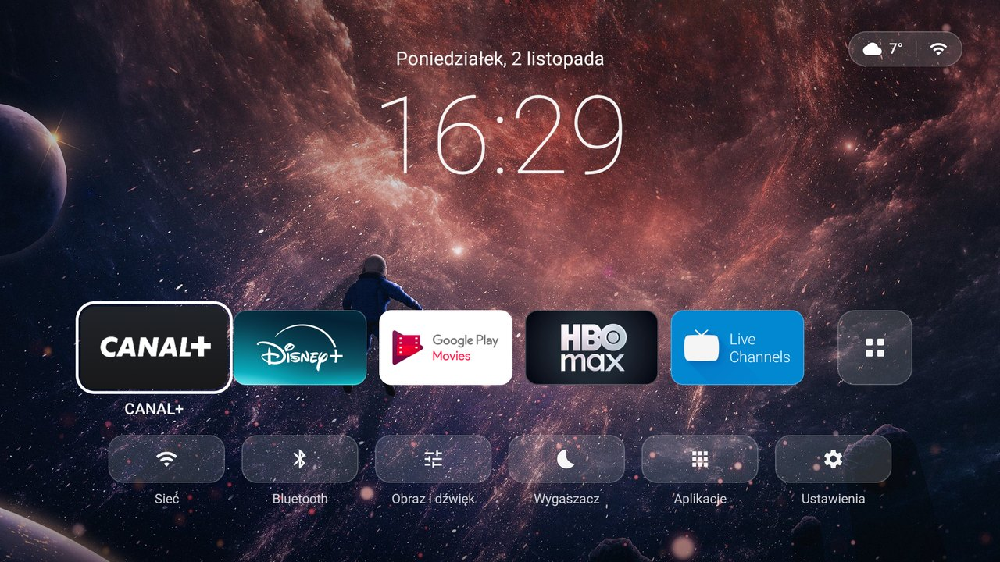
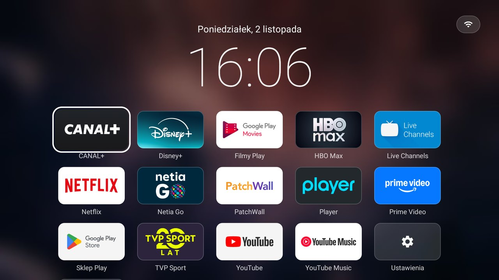
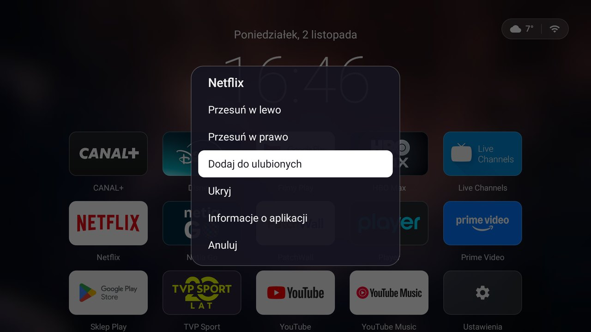
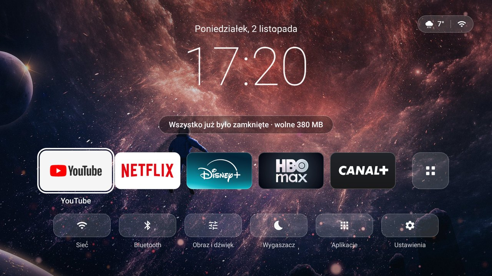
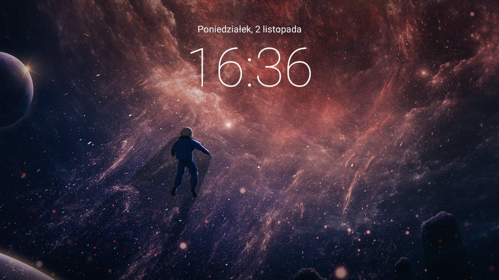

<div align="center">

# Czysty Launcher

**Lekki, płynny ekran główny dla Android TV.**
Zegar, tapeta i Twoje aplikacje: bez reklam, rekomendacji i podglądów.


[English version](README.en.md) · [Pobierz APK](../../releases/latest) · [Historia zmian](CHANGELOG.md)



</div>

## Dlaczego?

Fabryczny ekran Google TV to katalog: rzędy rekomendacji, banery, reklamy, a gdzieś pod spodem aplikacje, których naprawdę używasz. Na słabym sprzęcie, takim jak **Xiaomi Mi TV Stick** (Amlogic S805Y, 1 GB RAM), jest do tego wolny i zacina się przy każdym ruchu pilotem.

Czysty Launcher robi odwrotnie: po włączeniu telewizora pokazuje datę, duży zegar, tapetę i kilka ulubionych aplikacji. Napisany od zera w Kotlinie na klasycznych Android Views, **bez Jetpack Compose, bez AndroidX i bez żadnych bibliotek**. Każdą decyzję mierzyłem na prawdziwym Sticku.

## Funkcje

| | |
|---|---|
| 🏠 **Ekran główny** | Data po polsku, duży zegar, pogoda i stan sieci, dok z ulubionymi, szybkie ustawienia |
| 🧊 **Szklany styl** | Półprzezroczyste kafelki z ramką; po najechaniu powiększenie ×1,1 i biała obwódka |
| 📱 **Wszystkie aplikacje** | Siatka 5 kolumn na rozmytej tapecie; nowe aplikacje ze Sklepu Play pojawiają się same |
| ⭐ **Ulubione i porządek** | Przytrzymaj OK: przesuń, dodaj/usuń z ulubionych, ukryj, informacje o aplikacji |
| 🚀 **Przyspieszacz** | Przycisk z kółkiem zamyka aplikacje w tle i pokazuje, ile pamięci zwolniono |
| 🌙 **Wygaszacz** | Sama tapeta z datą i godziną, także jako systemowy wygaszacz ekranu |
| 🌤️ **Pogoda** | Open-Meteo, a gdy nie odpowiada, met.no albo wttr.in; bez konta i bez lokalizacji |
| ⚡ **Wydajność** | 0% zaciętych klatek przy nawigacji, ~25 MB pamięci, 0% CPU w spoczynku |

<table>
<tr>
<td><br><sub>Wszystkie aplikacje</sub></td>
<td><br><sub>Menu po przytrzymaniu OK</sub></td>
</tr>
<tr>
<td><br><sub>Przyspieszacz (przycisk z kółkiem)</sub></td>
<td><br><sub>Wygaszacz</sub></td>
</tr>
</table>

## Pilot

Na pilocie Xiaomi (Mi TV Stick / Mi Box):

| Przycisk | Działanie |
|---|---|
| **OK** | uruchamia aplikację |
| **Przytrzymanie OK** albo **Menu** | menu aplikacji: przesuń, ulubione, ukryj, informacje |
| **Wstecz** | zamyka menu / siatkę; na ekranie głównym nic nie robi |
| **Strzałka w górę** w pierwszym rzędzie siatki | powrót na ekran główny |
| **Kafelki** (pod pierścieniem strzałek, po lewej) | ekran główny, aplikacje zostają w tle ¹ |
| **Kółko** (pod pierścieniem strzałek, po prawej) | przyspieszacz: ekran główny + zamknięcie aplikacji w tle ¹ |

¹ Te dwa przyciski system obsługuje sam, więc launcher przejmuje je przez własną usługę ułatwień dostępu (patrz [instalacja](#4-przyciski-kafelki-i-kółko-opcjonalnie)). Usługa reaguje tylko na nie, pozostałe klawisze przepuszcza bez zmian i nie odczytuje zawartości ekranu. Bez niej kółko działa jak zwykły Home, a kafelki nic nie robią.

## Instalacja

Potrzebujesz komputera z [ADB (platform-tools)](https://developer.android.com/tools/releases/platform-tools) i telewizora z włączonym debugowaniem: *Ustawienia → Preferencje urządzenia → Informacje → 7× Kompilacja*, potem *Opcje programisty → Debugowanie USB / sieciowe*.

### 1. Instalacja i kompilacja AOT

```bash
adb connect ADRES_IP_TELEWIZORA:5555
adb install -r CzystyLauncher-3.0.apk
adb shell cmd package compile -m speed -f pl.czysty.launcher
```

Kompilacja `speed` jest opcjonalna, ale na słabym procesorze przyspiesza pierwsze uruchomienie.

### 2. Ustawienie jako ekran główny

Launcher Google ma wyższy priorytet, więc trzeba go wyłączyć (to odwracalne):

```bash
adb shell pm disable-user --user 0 com.google.android.tvlauncher
adb shell cmd package resolve-activity -a android.intent.action.MAIN -c android.intent.category.HOME
```

Drugie polecenie musi wskazywać `pl.czysty.launcher`. Jeśli wskazuje coś innego (na niektórych telewizorach Home przejmuje kreator konfiguracji), przywróć launcher Google i nie restartuj urządzenia:

```bash
adb shell pm enable com.google.android.tvlauncher
```

### 3. Wygaszacz (opcjonalnie)

```bash
adb shell settings put secure screensaver_components pl.czysty.launcher/.ScreensaverDream
```

### 4. Przyciski kafelki i kółko (opcjonalnie)

```bash
adb shell settings put secure enabled_accessibility_services pl.czysty.launcher/.RemoteKeyService
adb shell settings put secure accessibility_enabled 1
```

Wyłączenie: *Ustawienia → Ułatwienia dostępu* albo:

```bash
adb shell settings put secure accessibility_enabled 0
```

### Odinstalowanie

```bash
adb shell pm enable com.google.android.tvlauncher
adb uninstall pl.czysty.launcher
```

## Budowanie ze źródeł

Wymagania: JDK 17+ i Android SDK (platforma 35, build-tools 35). Ścieżkę do SDK wpisz w `local.properties` (`sdk.dir=...`) albo w zmiennej `ANDROID_HOME`.

```bash
./gradlew assembleRelease
```

Wynik: `app/build/outputs/apk/release/app-release.apk`. Bez własnego klucza release podpisuje się kluczem debug. Żeby podpisywać własnym kluczem (potrzebne do aktualizacji przez `install -r` bez utraty ustawień), utwórz w katalogu głównym `keystore.properties`. Plik jest w `.gitignore`:

```properties
storeFile=app/launcher.jks
storePassword=...
keyAlias=...
keyPassword=...
```

## Dostosowanie

- **Tapeta:** przygotuj własną z dowolnego zdjęcia 16:9. Skrypt zmniejsza ją do 1920×1080, przyciemnia górę i dół pod napisami i tworzy rozmytą wersję pod siatkę:
  ```bash
  python tools/prepare_wallpaper.py moje_zdjecie.jpg app/personal/res/raw
  ```
  Pliki w `app/personal/` nadpisują domyślną tapetę tylko w Twoich buildach i nie trafiają do repozytorium. `tools/generate_wallpaper.py` generuje gotową tapetę kosmosu (mgławice, gwiazdy, horyzont planety).
- **Miasto pogody:** współrzędne Krakowa są w stałych w [`Weather.kt`](app/src/main/java/pl/czysty/launcher/Weather.kt).
- **Domyślne ulubione:** dopóki nic nie zmienisz, w doku jest 5 pierwszych aplikacji alfabetycznie.

## Wydajność

Wszystko mierzone na Xiaomi Mi TV Stick (S805Y, 1 GB RAM, Android TV 9), na buildzie release po kompilacji AOT, narzędziami `dumpsys gfxinfo` i `dumpsys meminfo`:

| Pomiar | Wynik |
|---|---|
| Nawigacja po doku | 0% zaciętych klatek, p99 8–11 ms |
| Przewijanie siatki aplikacji | 0%, p99 8 ms |
| Otwarcie i zamknięcie siatki | 0%, p99 15 ms |
| Pierwsza klatka przy zimnym starcie | ~530 ms |
| Pamięć (PSS) | ~25–27 MB |
| CPU w spoczynku | 0% (zegar raz na minutę, pogoda co 30 min) |

Co za tym stoi:

- **Views zamiast Compose**, zero bibliotek: szybki start i przewidywalna nawigacja pilotem.
- **Tapeta to jeden statyczny obraz** z przyciemnieniem wypalonym w plik, bez gradientów, cieni i blura w czasie działania. Rozmyta wersja pod siatkę jest przygotowana zawczasu (480×270, skalowana przez GPU).
- **Podmiana tapety bez relayoutu:** osobny widok i samo `invalidate()`. Zmiana tła okna przeliczała układ całego ekranu (26% zaciętych klatek przy otwieraniu siatki).
- **Kafelki to gotowe bitmapy** w docelowym rozmiarze, z zaokrąglonymi rogami. Są renderowane raz i trzymane w pamięci oraz na dysku, a rysowanie to jedno `drawBitmap`.
- **Fokus przerysowuje tylko kafelek;** powiększenie idzie przez `ViewPropertyAnimator` na RenderThread.
- **Siatka budowana zawczasu** w `IdleHandler`, gdy wątek UI nic nie robi.
- **Wątki tła z niskim priorytetem;** ikona sieci przerysowuje się tylko przy zmianie stanu, a nie przy każdej zmianie siły sygnału Wi-Fi.

## Struktura projektu

```
app/src/main/java/pl/czysty/launcher/
├── MainActivity.kt      ekran główny, dok, siatka, menu, zegar, sieć, pogoda
├── Views.kt             kafelek aplikacji, szklany przycisk, tapeta, pozycja menu
├── AppRepository.kt     lista aplikacji, ulubione / kolejność / ukryte, cache kafelków
├── Weather.kt           pogoda: Open-Meteo → met.no → wttr.in
├── Screensaver.kt       wygaszacz (aktywność i systemowy DreamService), zegar
├── RemoteKeyService.kt  przyciski kafelki i kółko, przyspieszacz
├── Wallpaper.kt         wspólna, zdekodowana tapeta
├── Remote.kt            OK / przytrzymanie OK
└── Ui.kt                jednostki (ekran = 960×540 u), kolory, pomocnicze
tools/                   skrypty do tapety (Python + Pillow)
```

## Ograniczenia

- Testowane tylko na **Xiaomi Mi TV Stick 1080p (MiTV-AESP0), Android TV 9**. Na innych urządzeniach powinno działać, ale nie było sprawdzane.
- Interfejs jest po polsku.
- Przyspieszacz zamyka procesy w tle (`killBackgroundProcesses`). Bez roota nie da się zrobić „wymuszonego zatrzymania” ani czyścić cache, a aplikacje z usługą pierwszoplanową (np. grająca muzyka) zostają.
- Przycisk „Bluetooth” otwiera ogólne Ustawienia, bo Android TV 9 na Sticku nie ma osobnego ekranu Bluetooth.
- Niektóre aplikacje mogą zachowywać się inaczej, gdy wykryją włączone ułatwienia dostępu (punkt 4 instalacji).

## Podziękowania

- Pomysł i styl: [Aether TV](https://mycloudrise.com/projects/aether-tv/) (launcher dla telewizora Haier). Czysty Launcher to niezależna implementacja, bez kodu Aether.
- Dane pogodowe: [Open-Meteo](https://open-meteo.com/) (CC BY 4.0), [MET Norway](https://api.met.no/) (CC BY 4.0), [wttr.in](https://wttr.in/).
- Ikony: ścieżki wzorowane na [Material Icons](https://fonts.google.com/icons) (Apache 2.0).

## Licencja

Kod jest na licencji [MIT](LICENSE). Licencja nie obejmuje zdjęcia tapety (`app/src/main/res/raw/bg*.jpg`): to obraz z internetu, a prawa należą do jego autora. Jeśli jesteś autorem i chcesz, żeby zniknął z repozytorium, otwórz issue.
